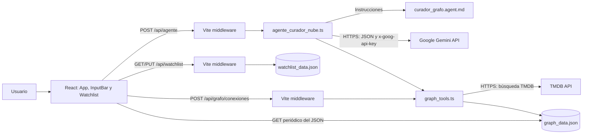

# 🎬 Motor de Recomendación Visual con IA

## 1. 🚀 Descripción general

Aplicación web académica para explorar y mantener recomendaciones de películas mediante un **grafo dirigido e interactivo**. Cada película es un nodo y cada recomendación es una arista orientada desde la película de origen hacia la recomendada. La interfaz utiliza React, Vite y React Flow; el agente CuradorGrafo consulta Gemini para interpretar pedidos, obtiene metadatos de TMDB y actualiza la persistencia local del grafo.

Las capacidades principales son:

- Visualizar y explorar el grafo con nodos de película personalizados y conexiones dirigidas.
- Buscar títulos y metadatos en TMDB.
- Crear lotes de recomendaciones y eliminar películas o ramas del grafo.
- Administrar una lista de favoritas con películas pendientes o vistas (`completed`).
- Obtener sugerencias personalizadas a partir de las películas vistas y elegir cuáles conexiones persistir.
- Ejecutar pruebas unitarias y de integración con Vitest y respuestas externas simuladas.

El agente se invoca mediante `POST /api/agente`. **No se utiliza un servidor MCP** en el flujo actual. La arquitectura separa interfaz, orquestación, herramientas y adaptador HTTP por módulos, pero no constituye DDD o Clean Architecture estricta: la persistencia se realiza directamente en archivos JSON y el backend no es un servicio independiente.

## 2. 🏗️ Arquitectura y diseño del sistema

### Topología y flujo de datos

El frontend React y las APIs locales se ejecutan bajo el servidor de desarrollo de Vite. El plugin de `frontend/vite.config.ts` registra middlewares que, al recibir solicitudes, leen o escriben los JSON locales o cargan dinámicamente `backend/src/agente_curador_nube.ts`. No hay que iniciar un segundo servidor backend.



1. **Solicitud al agente:** `InputBar.tsx` envía `{ prompt, source }` a `/api/agente`. El middleware limita y valida la solicitud; la orquestación carga el estado actual del grafo y la watchlist, lee las instrucciones del agente, llama a Gemini, interpreta el JSON y ejecuta la acción correspondiente.
2. **Actualización del grafo visible:** `App.tsx` consulta `/src/data/graph_data.json` con cache-busting aproximadamente cada segundo y mapea sus nodos y aristas a React Flow.
3. **Watchlist:** `useWatchlist.ts` usa `GET /api/watchlist` para leer y `PUT /api/watchlist` para guardar el array completo en `watchlist_data.json`. No se lee ni se migra información desde `localStorage`.
4. **Guardar sugerencias:** el usuario puede seleccionar recomendaciones de la previsualización. El panel las envía a `/api/grafo/conexiones`, que valida el origen y delega la escritura en `addRecommendationsToGraph`.

Los middlewares registrados mediante `configureServer` corresponden al **servidor de desarrollo de Vite**. `vite build` genera archivos estáticos, pero no convierte esos middlewares en un backend de producción. Un despliegue fuera del modo de desarrollo necesita un servidor o adaptador que implemente estas APIs y gestione de forma segura la persistencia y las claves.

### Endpoints locales

| Endpoint | Responsabilidad y contrato | Validaciones principales |
|---|---|---|
| `POST /api/agente` | Recibe `{ "prompt": string, "source"?: string }` y ejecuta el agente. | Límite del body: 10.000 bytes. `prompt`: string no vacío, máximo 300 caracteres. JSON o prompt inválido: 400; body excedido: 413. Solo `source: "watchlist_panel"` se reconoce como origen del panel; otros valores se tratan como `search_bar`. |
| `GET /api/watchlist` | Lee la watchlist; inicializa el archivo y responde `[]` si no existe o está vacío. | Errores de lectura inesperados: 500. |
| `PUT /api/watchlist` | Valida y reemplaza el array persistido usando archivo temporal y `rename`. | Límite de `body.length > 1_000_000` (unidades de cadena JavaScript, no bytes). Comprueba estructura, tipos y estados opcionales; datos inválidos: 400, límite excedido: 413. |
| `POST /api/grafo/conexiones` | Recibe `{ "sourceId": string, "recommendations": [...] }` y persiste conexiones para un origen existente. | Límite de 100.000 caracteres y máximo de tres recomendaciones. Valida origen, título, póster, motivo y campos opcionales; JSON/datos inválidos: 400, límite excedido: 413. |

### Modelo de datos y persistencia

Los tipos compartidos se definen en `frontend/src/data/interfaces.ts`:

- `GraphData`: `{ nodes: GraphMovie[], edges: GraphEdge[] }`.
- `GraphMovie`: `id`, `title`, `poster` y campos opcionales `description` y `genres`.
- `GraphEdge`: `id`, `source`, `target` y `label` opcional.
- `WatchlistItem`: `id`, `title`, `poster`, géneros opcionales y estado opcional `pending` o `completed`.
- `MovieBatchInput`: película con origen, motivo, géneros y descripción opcionales.
- `TmdbMovieResult`: resultado TMDB normalizado para el backend.

`frontend/src/data/graph_data.json` almacena el grafo como un objeto con arrays `nodes` y `edges`. `frontend/src/data/watchlist_data.json` almacena un array de favoritas. `readGraph` informa errores si no puede leer o validar la estructura; `readWatchlist` devuelve un array vacío si el archivo falta o no tiene contenido.

## 3. 🤖 Agente declarativo y Skills

`.github/agents/curador_grafo.agent.md` declara el rol del agente, las reglas de selección y el formato JSON de respuesta. `cargarPromptAgente()` lee el archivo y elimina su frontmatter antes de enviarlo como instrucción de sistema a Gemini. `ejecutarCuradorGrafo()` valida y orquesta la respuesta y llama las funciones de `graph_tools.ts`; no ejecuta herramientas mediante MCP.

| Skill | Protocolo |
|---|---|
| **Skill 1 — Creación por lote** | Resuelve la película inicial y exactamente tres recomendaciones con TMDB; guarda el nodo inicial y las recomendaciones en una llamada por lote a `addToGraph`, enlazando cada recomendación con su origen. |
| **Skill 2 — Eliminación y limpieza** | `removeFromGraph` elimina el nodo solicitado, sus hijos recomendados y las aristas incidentes. `clearRecommendations` elimina los nodos recomendados y sus aristas, pero conserva el nodo de origen. |
| **Skill 3 — Sugerencias personalizadas** | Usa películas `completed` como origen, produce tres candidatas por origen y devuelve grupos para previsualización sin modificar el grafo. El usuario puede elegir las conexiones que se guardarán desde la interfaz. |
| **Skill 4 — Recomendaciones automáticas desde Favoritas** | Ante una solicitud explícita, obtiene tres recomendaciones por cada película vista, resuelve sus metadatos con TMDB y guarda las conexiones sin solicitar confirmación adicional. |

Las Skills 3 y 4 no utilizan favoritas pendientes como origen y descartan recomendaciones duplicadas o ya presentes según las reglas declaradas. Si no hay películas vistas, devuelven grupos vacíos y no hay recomendaciones que persistir.

### Gemini, parámetros y telemetría

- `GEMINI_API_KEY` se envía en la cabecera `x-goog-api-key`; no se incorpora al bundle del navegador.
- La generación configura `temperature: 0.1`, `topP: 0.8`, `maxOutputTokens: 1024` y solicita JSON mediante `responseMimeType`.
- `llamarGeminiNube()` itera sobre `MODELOS_GEMINI_POOL` y puede avanzar al siguiente modelo ante fallos de red o HTTP. La lista activa actualmente solo contiene `gemini-3.5-flash-lite`, así que no hay un modelo alternativo configurado.
- La telemetría incluye modelo, duración y cantidades de tokens de entrada, salida y totales; también se informa en la salida del proceso backend.
- `extraerJsonRobusto()` parsea JSON limpio o extrae el objeto JSON de una respuesta con bloques Markdown y texto adicional.

## 4. 📂 Mapa estructural del repositorio

```text
/
├── README.md                         # Documentación del proyecto
├── .gitignore                        # Dependencias, builds, cachés, secretos y logs ignorados
├── package-lock.json                 # Lockfile raíz existente; no hay package.json raíz
├── .vscode/                          # Configuración del espacio de trabajo
├── .github/
│   └── agents/
│       ├── curador_grafo.agent.md    # Prompt, reglas y formato de salida de CuradorGrafo
│       ├── qa_tester.agent.md        # Configuración del agente de QA
│       └── sec_auditor.agent.md      # Configuración del agente de auditoría de seguridad
├── backend/
│   ├── .env                          # Configuración local ignorada por Git; no versionar
│   ├── .env.example                  # Nombres de variables requeridas, sin credenciales
│   ├── package.json / package-lock.json
│   │                                 # Dependencias backend y script npm test
│   ├── tsconfig.json                 # TypeScript NodeNext
│   └── src/
│       ├── agente_curador_nube.ts    # Gemini, parseo, telemetría y ejecución de Skills
│       └── graph_tools.ts            # TMDB y operaciones/persistencia del grafo y watchlist
├── frontend/
│   ├── README.md                     # README del template Vite
│   ├── index.html                    # Documento HTML de entrada
│   ├── package.json / package-lock.json
│   │                                 # React, Vite, React Flow y herramientas frontend
│   ├── vite.config.ts                # Plugin React y middlewares locales de API
│   ├── tsconfig*.json                # Configuración TypeScript de app y tooling
│   ├── eslint.config.js              # Reglas de ESLint
│   ├── public/                       # Recursos estáticos públicos
│   └── src/
│       ├── main.tsx                  # Montaje de React
│       ├── App.tsx                   # Estado del grafo, sincronización y React Flow
│       ├── App.css / index.css       # Estilos de aplicación y globales
│       ├── components/
│       │   ├── InputBar.tsx          # Entrada, límite de consulta y llamada al agente
│       │   ├── InputBar.css          # Estilos de la barra de búsqueda
│       │   ├── MovieCardNode.tsx     # Nodo de película personalizado
│       │   ├── WatchlistSidebar.tsx  # Panel de favoritas y solicitud de sugerencias
│       │   ├── WatchlistSidebar.css  # Estilos del panel de favoritas
│       │   └── WatchlistRecommendationsPanel.tsx
│       │                              # Previsualización y guardado de conexiones
│       ├── hooks/
│       │   └── useWatchlist.ts       # Estado, clasificación y persistencia de favoritas
│       └── data/
│           ├── interfaces.ts         # Contratos de datos compartidos
│           ├── graph_data.json       # Persistencia local de nodos y aristas
│           └── watchlist_data.json   # Persistencia local de favoritas
└── tests/
    ├── tsconfig.json                 # Configuración TypeScript de pruebas
    ├── graph_tools.test.ts           # Suite unitaria y de integración con Vitest
    └── mocks/
        └── tmdb.mock.ts              # Respuestas simuladas y grafo inicial de pruebas
```

`node_modules`, `frontend/dist` y `.vite` son dependencias o resultados generados, no código fuente. Frontend y backend mantienen instalaciones y lockfiles separados.

## 5. 🛡️ Seguridad y calidad

### Controles implementados y límites

- **Validación del prompt:** `InputBar.tsx` limita la entrada a 300 caracteres con `maxLength` y comprueba la longitud antes de enviarla. El middleware repite la validación del tipo, contenido no vacío y longitud, sin confiar en el navegador.
- **Límites de payload:** `/api/agente` limita el body a 10.000 bytes; `/api/grafo/conexiones`, a 100.000 caracteres; y `PUT /api/watchlist`, a 1.000.000 unidades de longitud de cadena JavaScript.
- **Validación de estructuras:** las APIs comprueban el JSON recibido y los tipos de los campos antes de escribir. Las conexiones aceptan hasta tres recomendaciones.
- **Gestión de credenciales:** las claves deben mantenerse en `backend/.env`, excluido de Git. Gemini usa `x-goog-api-key`. TMDB actualmente envía `TMDB_API_KEY` en el parámetro `api_key` de la URL construida en el backend; no debe exponerse ni registrarse esa URL.
- **Errores de TMDB:** `searchTmdb` normaliza fallos de red y parseo para no propagar mensajes crudos que pudieran incluir URL o clave. En un error HTTP, informa el estado sin devolver la URL.
- **Escritura de watchlist:** `PUT /api/watchlist` escribe primero un archivo temporal y lo renombra al destino para reducir el riesgo de dejar el JSON parcialmente escrito.

Estos controles protegen los flujos locales actuales, pero no equivalen a una política completa de producción. En particular, los errores del middleware de `/api/agente` pueden incluir el mensaje de la excepción recibida; un despliegue público debería definir manejo centralizado de errores, autenticación/autorización, límites por IP y gestión de secretos apropiada.

### Estrategia de pruebas

`tests/graph_tools.test.ts` usa Vitest y agrupa pruebas unitarias y de integración. Los casos siguen AAA (`Arrange`, `Act`, `Assert`). Los tests de TMDB simulan `globalThis.fetch` con `vi.spyOn`, sin llamadas HTTP externas. Las pruebas del grafo usan un estado inicial controlado y respaldan/restauran el contenido original de `graph_data.json` en los hooks.

La suite cubre parseo JSON limpio y con Markdown/texto adicional, entradas y arrays vacíos, búsqueda TMDB exitosa y sin resultados, errores de red/parseo sin filtrar URL y el flujo de agregar recomendaciones, limpiar ramas y eliminar el nodo raíz.

Comandos de validación:

```powershell
# Desde frontend/
npx vitest run --root ..
npm run lint
npm run build

# Alternativa para ejecutar Vitest desde backend/
npm test
```

`npm run build` ejecuta `tsc -b` antes de Vite. La configuración actual de `frontend/tsconfig.node.json` incluye `tests/**/*.ts`; por tanto, el build completo también depende de la resolución de Vitest y de los módulos de prueba en ese proyecto TypeScript.

## 6. ⚙️ Configuración, instalación e inicio

### Requisitos

- Node.js 20 LTS o superior y npm.
- Clave de Google Gemini para interpretar los pedidos.
- Clave de The Movie Database (TMDB) para resolver títulos y metadatos.
- Navegador moderno y conexión de red para las APIs externas.

Puedes obtener las claves en [Google AI Studio](https://aistudio.google.com/app/apikey) y en la [documentación para desarrolladores de TMDB](https://developer.themoviedb.org/docs/getting-started).

### Instalación de dependencias

Los paquetes usan dependencias y carpetas `node_modules` independientes. Desde la raíz:

```powershell
cd frontend
npm install
cd ..\backend
npm install
```

### Variables de entorno

Crea `backend/.env` a partir de `backend/.env.example` y agrega tus propias credenciales:

```env
GEMINI_API_KEY=tu_clave_de_gemini
TMDB_API_KEY=tu_clave_de_tmdb
```

No compartas ni subas este archivo con claves reales. `graph_tools.ts` valida `TMDB_API_KEY` al cargarse; Gemini requiere `GEMINI_API_KEY` al realizar una llamada.

### Archivos de datos iniciales

El grafo debe tener arrays `nodes` y `edges`. La watchlist debe ser un array JSON. Para iniciar sin elementos:

Contenido inicial de `frontend/src/data/graph_data.json`:

```json
{
  "nodes": [],
  "edges": []
}
```

Contenido inicial de `frontend/src/data/watchlist_data.json`:

```json
[]
```

Estos archivos son la persistencia local; conservarlos mantiene los datos guardados por la aplicación.

### Inicio desde Visual Studio Code

1. Abre en VS Code la raíz del repositorio, que contiene `frontend`, `backend` y `.github`.
2. Configura `backend/.env` con las claves antes de iniciar la aplicación.
3. Abre **Terminal > Nueva terminal** y ejecuta:

```powershell
cd frontend
npm run dev
```

Vite muestra la dirección local, normalmente `http://localhost:5173`. Mantén esa terminal abierta mientras uses la aplicación. No es necesario iniciar el backend en otra terminal: Vite atiende los endpoints y carga el agente cuando recibe una solicitud. Tampoco es necesario configurar MCP.

### Uso

Escribe un pedido en la barra de búsqueda, por ejemplo:

> Recomendar películas como Interstellar

También puedes solicitar eliminar una película o borrar solo sus recomendaciones. El agente muestra su respuesta bajo la barra; `App.tsx` refleja los cambios del grafo al volver a leer el JSON. La watchlist se consulta y guarda mediante la API local de Vite, no mediante `localStorage`.
